# Скріншоти EasyStock

Виконав: Бондаренко Сергій

Знімки локального запуску, надані автором 18.10.2026. Дані на екранах належать демонстраційній базі.

[Повернутися до головного README](../../README.md)

## 1. Вхід у систему

Початкова форма входу та кнопки вибору демонстраційної ролі.

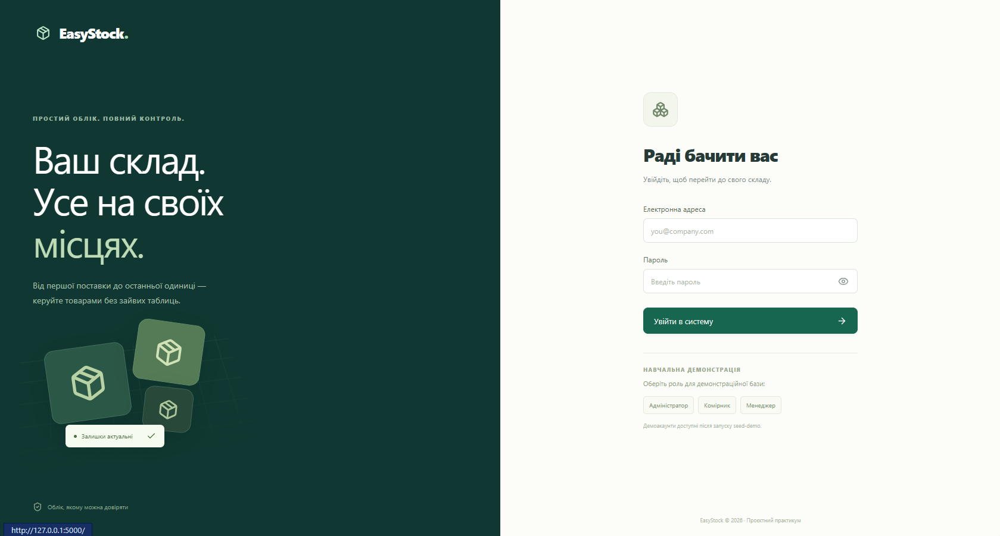

## 2. Вхід із демонстраційним обліковим записом

Форма із заповненим email адміністратора; пароль прихований.

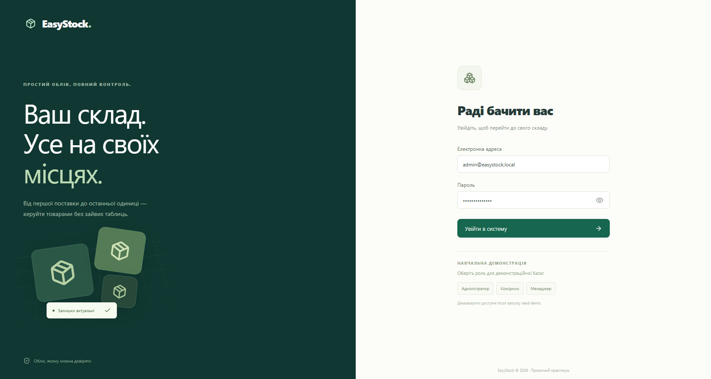

## 3. Огляд складу та основні показники

Кількість товарних позицій, залишки, вартість запасів, товари для поповнення та графік руху.

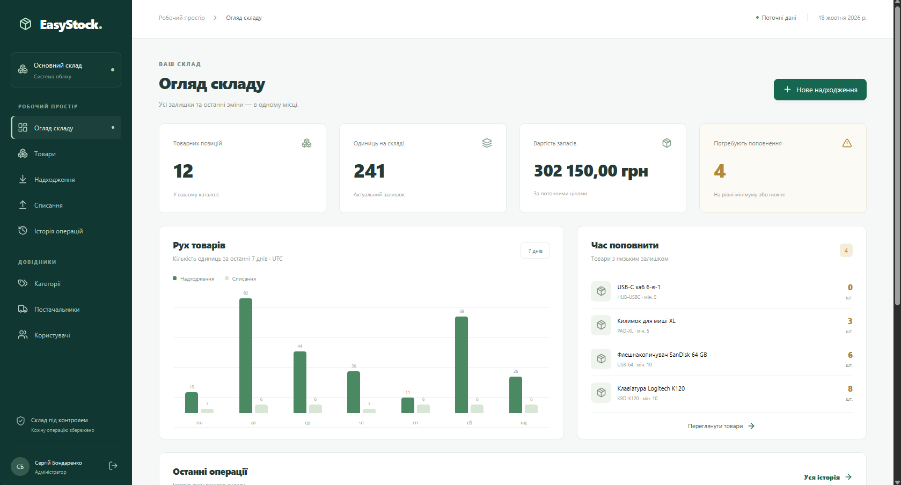

## 4. Останні операції на головній сторінці

Список останніх надходжень і списань у демонстраційній базі.

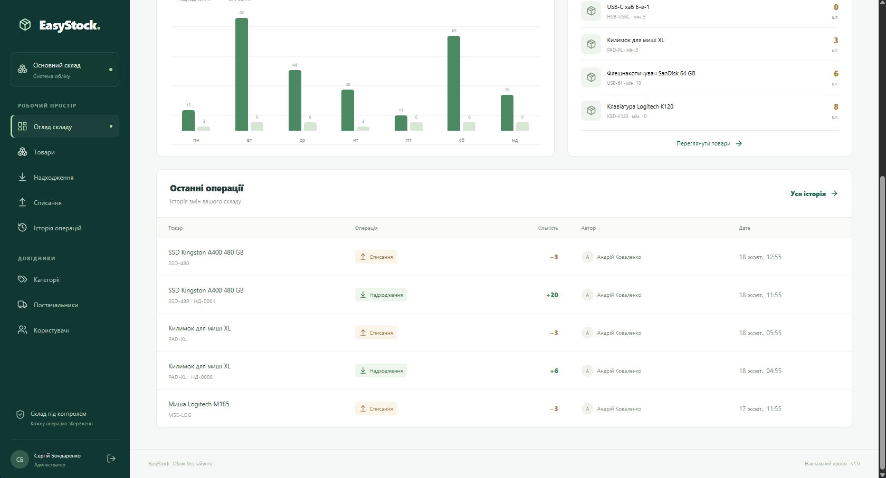

## 5. Каталог товарів із залишками та фільтрами

Таблиця товарів, пошук і поля фільтрації за категорією та залишком.

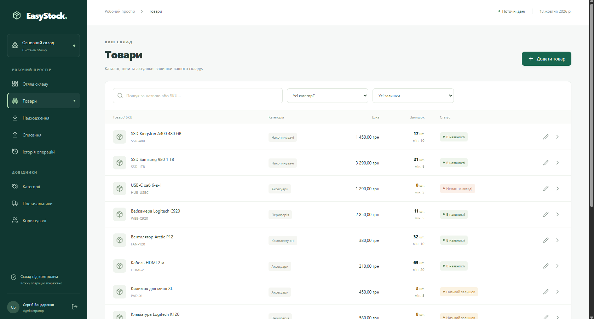

## 6. Форма нового надходження

Вибір товару, кількості, ціни та постачальника перед проведенням надходження.

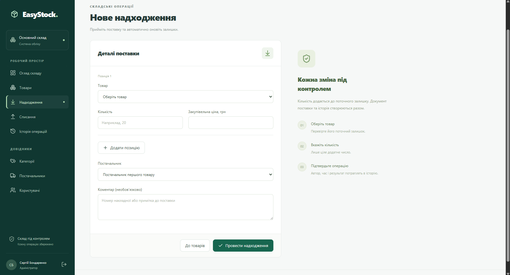

## 7. Форма списання товару

Поля вибору товару, кількості та коментаря перед проведенням списання.

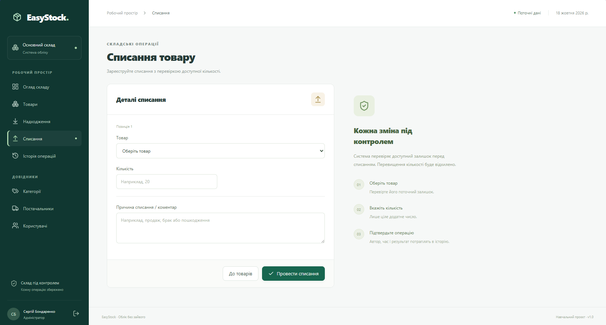

## 8. Історія складських операцій

Журнал операцій із датою, автором, кількістю, залишком після операції та фільтрами.

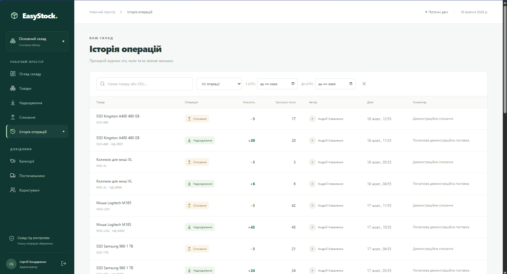

## 9. Довідник категорій

Перелік категорій і доступні адміністратору дії керування.

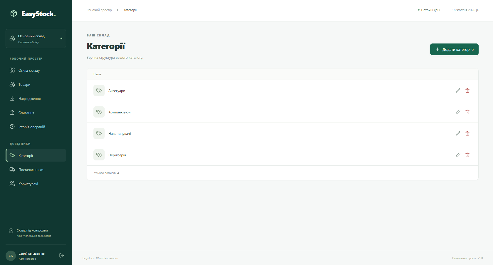

## 10. Довідник постачальників

Перелік демонстраційних постачальників і дії керування довідником.

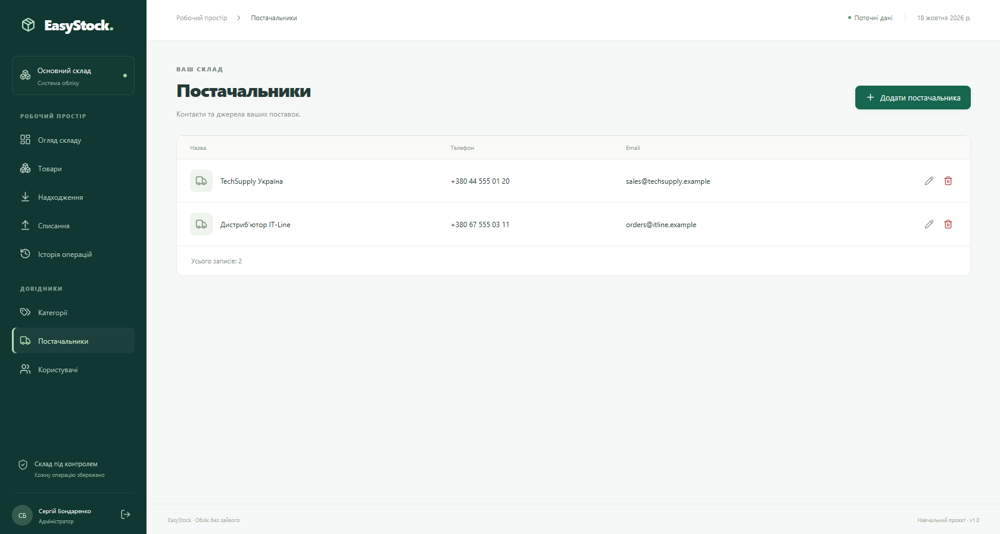

## 11. Користувачі та ролі доступу

Облікові записи адміністратора, комірника та менеджера, їхні ролі й статуси.

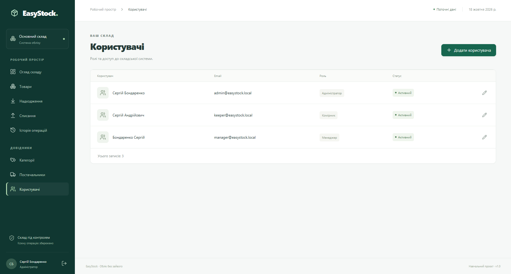

## 12. Успішний запуск EasyStock у Windows

Термінал із запуском сервера за адресою http://127.0.0.1:5000 та повідомленням про збереження наявної бази даних.

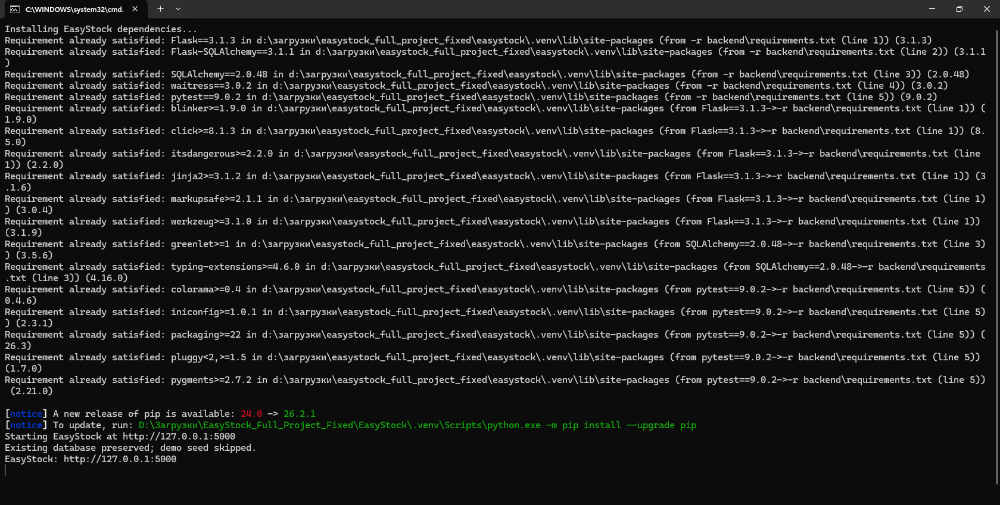

## 13. Структура локальної папки проєкту після запуску

Папки та файли розпакованого проєкту у Провіднику Windows. Середовище .venv створено локально під час запуску.

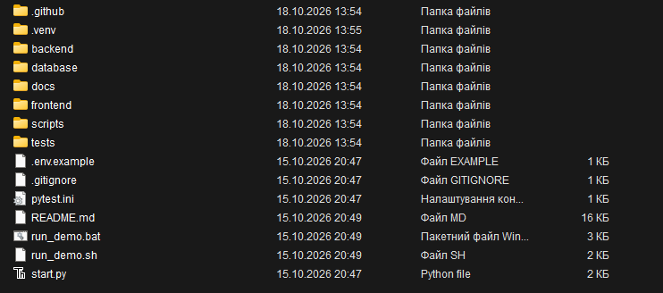
